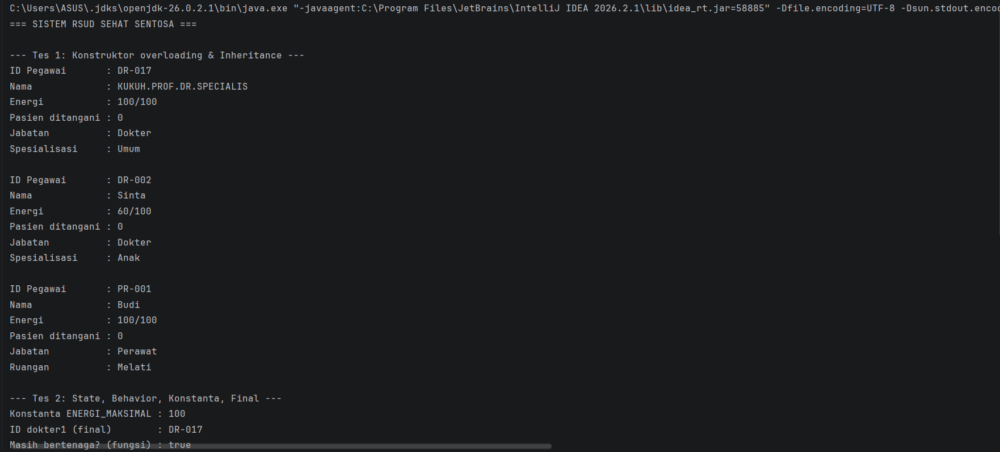
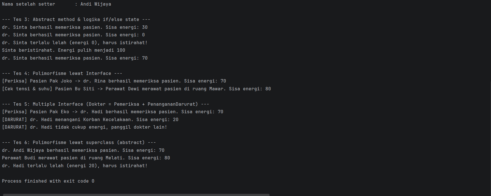

# Responsi Akhir Praktikum PBO - Sistem Rumah Sakit

## Identitas
| |                                                              |
|---|--------------------------------------------------------------|
| Nama | **(KUKUH ABDULOH KURNIAWAN)**                                |
| NIM | **(H1D025017, digit terakhir 7)**                            |
| Tema | **Rumah Sakit** (digit terakhir NIM 6 dan 7)                 |
| Jurusan | Informatika, Fakultas Teknik, Universitas Jenderal Soedirman |

## Struktur Project
```
src/
├── Main.java               -> class pengujian (terpisah)
├── PetugasMedis.java       -> abstract superclass
├── Dokter.java             -> subclass (implements Pemeriksa, PenangananDarurat)
├── Perawat.java            -> subclass (implements Pemeriksa)
├── Pemeriksa.java          -> interface 1
└── PenangananDarurat.java  -> interface 2
```

## Cara Compile dan Run (Terminal)
Pastikan JDK sudah terpasang (`javac -version`). Dari folder utama project:

```bash
mkdir out
javac -d out src/*.java
java -cp out Main
```
Di Windows PowerShell/CMD: `javac -d out src\*.java` lalu `java -cp out Main`.

## Pemetaan 10 Persyaratan
| No | Konsep | Lokasi |
|----|--------|--------|
| 1 | State & Behavior | `PetugasMedis`: atribut, `istirahat()` (void), `masihBertenaga()` (return) |
| 2 | Immutability | `NAMA_RUMAH_SAKIT`, `ENERGI_MAKSIMAL` (public static final); `idPegawai` (private final) |
| 3 | Enkapsulasi & Overloading | Semua atribut private + getter/setter, `this`, 2 konstruktor per class |
| 4 | Inheritance | `Dokter` dan `Perawat` extends `PetugasMedis`; `Main` terpisah |
| 5 | Super Chaining | `super(...)` di konstruktor subclass; `super.tampilkanInfo()` |
| 6 | Method Overriding | `@Override` pada `bekerja()` dan `tampilkanInfo()` |
| 7 | Abstract Class | `PetugasMedis` abstract, punya `abstract String bekerja()` |
| 8 | Logika State | `bekerja()` pakai if/else membaca & mengubah `energi` |
| 9 | Polimorfisme Interface | `Pemeriksa p = new Dokter(...)` di `Main` |
| 10 | Multiple Interface | `Dokter implements Pemeriksa, PenangananDarurat` |




```
=== SISTEM RSUD SEHAT SENTOSA ===

--- Tes 1: Konstruktor overloading & Inheritance ---
ID Pegawai       : DR-001
Nama             : Andi
Energi           : 100/100
Pasien ditangani : 0
Jabatan          : Dokter
Spesialisasi     : Umum

ID Pegawai       : DR-002
Nama             : Sinta
Energi           : 60/100
Pasien ditangani : 0
Jabatan          : Dokter
Spesialisasi     : Anak

ID Pegawai       : PR-001
Nama             : Budi
Energi           : 100/100
Pasien ditangani : 0
Jabatan          : Perawat
Ruangan          : Melati

--- Tes 2: State, Behavior, Konstanta, Final ---
Konstanta ENERGI_MAKSIMAL : 100
ID dokter1 (final)        : DR-001
Masih bertenaga? (fungsi) : true
Nama setelah setter       : Andi Wijaya

--- Tes 3: Abstract method & logika if/else state ---
dr. Sinta berhasil memeriksa pasien. Sisa energi: 30
dr. Sinta berhasil memeriksa pasien. Sisa energi: 0
dr. Sinta terlalu lelah (energi 0), harus istirahat!
Sinta beristirahat. Energi pulih menjadi 100
dr. Sinta berhasil memeriksa pasien. Sisa energi: 70

--- Tes 4: Polimorfisme lewat Interface ---
[Periksa] Pasien Pak Joko -> dr. Rina berhasil memeriksa pasien. Sisa energi: 70
[Cek tensi & suhu] Pasien Bu Siti -> Perawat Dewi merawat pasien di ruang Mawar. Sisa energi: 80

--- Tes 5: Multiple Interface (Dokter = Pemeriksa + PenangananDarurat) ---
[Periksa] Pasien Pak Eko -> dr. Hadi berhasil memeriksa pasien. Sisa energi: 70
[DARURAT] dr. Hadi menangani Korban Kecelakaan. Sisa energi: 20
[DARURAT] dr. Hadi tidak cukup energi, panggil dokter lain!

--- Tes 6: Polimorfisme lewat superclass (abstract) ---
dr. Andi Wijaya berhasil memeriksa pasien. Sisa energi: 70
Perawat Budi merawat pasien di ruang Melati. Sisa energi: 80
dr. Hadi terlalu lelah (energi 20), harus istirahat!
```
